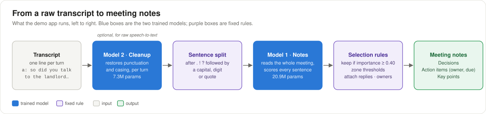
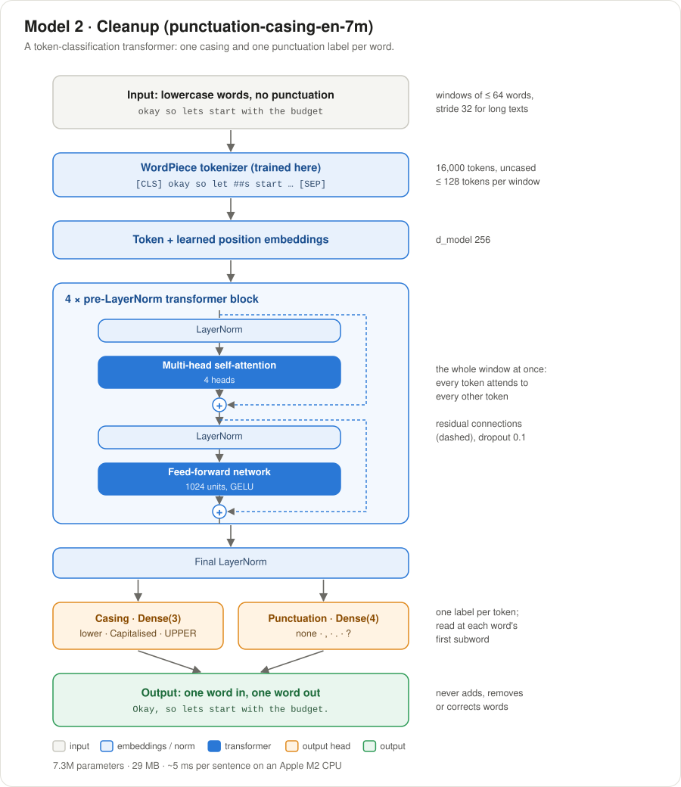
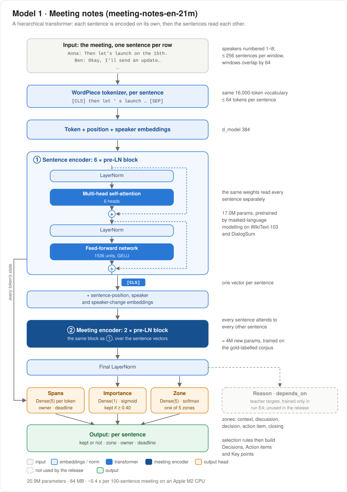

# Note_taker


**Topics:** `keras` · `jax` · `transformers-from-scratch` · `meeting-notes` ·
`extractive-summarization` · `action-items` · `punctuation-restoration` · `truecasing` ·
`speech-to-text` · `knowledge-distillation` · `hugging-face` · `dash`

Two small transformer models, **built from scratch** with Keras 3 on the JAX backend (own
WordPiece tokenizer, own architectures, no pretrained weights), and a demo app that chains them:

| Model | What it does | Size | Hugging Face |
|---|---|---|---|
| **Model 2 – Cleanup** | Restores punctuation and casing in lowercase speech-to-text output | 7.3M params, 29 MB | [punctuation-casing-en-7m](https://huggingface.co/Jvachier/punctuation-casing-en-7m) |
| **Model 1 – Meeting notes** | Picks the sentences of a meeting that matter and sorts them into decisions, action items (owner, deadline) and key points | 20.9M params, 84 MB | [meeting-notes-en-21m](https://huggingface.co/Jvachier/meeting-notes-en-21m) |

Both run on CPU. Headline results (test sets, mean ± std over 3 seeds):
- **Cleanup:** punctuation macro-F1 0.789 ± 0.001 and casing accuracy 0.965 on DialogSum
  ([table](results/tables/model2_cleanup.md)).
- **Meeting notes:** importance F1 0.578 ± 0.006 on real AMI meetings, on par with a fine-tuned
  DistilBERT (0.580, 3× larger) and below RoBERTa-Large (0.634, 17× larger)
  ([table](results/tables/model1_v3.md)). Model 1 is extractive: it selects sentences, it does
  not write new text.

The model cards describe the data, training, limitations and licences. Model 1 is trained on
the corpus `meeting-notes-extractive-v1`, on
[Hugging Face](https://huggingface.co/datasets/Jvachier/meeting-notes-extractive-v1) and
[Kaggle](https://www.kaggle.com/datasets/jvachier/meeting-notes-extractive-v1).
[PLAN.md](PLAN.md) is the full design and the log of every decision.

## How the models work

The demo app chains both models. Model 2 is optional and only needed for raw speech-to-text.
Fixed rules turn Model 1's per-sentence predictions into notes.



**Model 2 – Cleanup** is a token-classification transformer. It reads lowercase words without
punctuation and predicts, for every word, its casing and the punctuation mark that follows it.
It never adds, removes or corrects words.



**Model 1 – Meeting notes** is hierarchical. A sentence encoder, pretrained by masked-language
modelling, reads each sentence on its own. A meeting encoder then lets the sentence vectors
attend to each other, so a sentence is judged in the context of the whole meeting. Per-sentence
heads predict whether the sentence belongs in the notes and its zone. A per-token head finds the
owner and the deadline.



## Use the models

```bash
pip install "keras>=3.6" jax tokenizers huggingface_hub
```

```python
import sys
from huggingface_hub import snapshot_download

folder = snapshot_download("Jvachier/meeting-notes-en-21m")
sys.path.insert(0, folder)
import modeling  # the model's own code, shipped in the repo

notetaker = modeling.NoteTaker.from_folder(folder)
print(
    notetaker("Anna: Then let's launch on the 15th.\nBen: Okay, I'll send an update on Wednesday.")
)
```

Each Hub repo has an `example.py`. For raw transcripts, the meeting-notes example first runs the
cleanup model.

## Demo app

A Dash app with both models: punctuation restoration, and meeting notes from a transcript (one
`Name: text` line per turn), with a chart of every sentence's importance.

```bash
export HF_NAMESPACE=Jvachier     # the Hub account hosting the models (or put it in a .env file)
docker compose up --build        # open http://localhost:8050
```

Without Docker: `uv sync --extra app`, then `uv run python -m app.main`. Models load from
`./release/` if present (see [Release](#release)), else from the Hub repos
`$HF_NAMESPACE/punctuation-casing-en-7m` and `$HF_NAMESPACE/meeting-notes-en-21m`.
`MODEL2_SOURCE` and `MODEL1_SOURCE` override either one with a local folder or a Hub repo ID,
and `MODEL_REVISION` pins a Hub branch, tag or commit. In Docker, gunicorn serves the app (one worker, four threads),
and inputs are capped at 20,000 characters per request.

## Development

```bash
uv sync                                          # dev environment (no PyTorch, no TensorFlow)
uv run pytest -q                                 # tests
uv run ruff check . --fix && uv run ruff format . # lint and format
uv run pre-commit install                        # run the same checks before every commit
```

CI ([`.github/workflows/ci.yaml`](.github/workflows/ci.yaml)) runs `pre-commit run --all-files`
on every pull request and push to `main`: YAML/TOML checks, a large-file guard, ruff, ruff
format and pytest. The Kaggle notebooks are executed end to end only with `RUN_NOTEBOOKS=1`.

Every hyperparameter lives in [`configs/`](configs/). A config can inherit from another with
`base: <file>.yaml`; `src.config.load_config` returns the resolved dict. Data, checkpoints and
release folders are git-ignored. The result tables, metrics and run manifests behind the
published models are tracked in [`results/`](results/).

## Reproduce

Full training runs on Kaggle GPUs, with self-contained notebooks in
[`notebooks/kaggle/`](notebooks/kaggle/) that checkpoint and resume. They do not import this
repo's code. Tests check that the notebooks' classes match `src/`. Bring a notebook's outputs
back with `uv run python notebooks/kaggle/fetch_outputs.py <notebook>`. Smoke configs
(`configs/*_tiny.yaml`) run each stage on CPU in under two minutes.

**Model 2 – Cleanup** (notebook `model2_cleanup.ipynb`, one session):

```bash
uv run python -m src.data.download --config configs/data.yaml                  # WikiText-103 + DialogSum
uv run python -m src.tokenizer.train --config configs/tokenizer.yaml           # WordPiece, 16k
uv run python -m src.model2_cleanup.build_data --config configs/model2.yaml    # int32 arrays
uv run python -m src.model2_cleanup.train --config configs/model2.yaml --all-seeds
uv run python -m src.eval.aggregate --exp model2_cleanup                       # results table
```

**Model 1 – Meeting notes, v3** (PLAN.md §10). Training data is the gold-labelled corpus
`meeting-notes-extractive-v1` ([Hugging Face](https://huggingface.co/datasets/Jvachier/meeting-notes-extractive-v1), [Kaggle](https://www.kaggle.com/datasets/jvachier/meeting-notes-extractive-v1))
(v1.1, in `data/raw/meeting_notes_v1_1/`). The sentence encoder starts from the MLM checkpoint
`checkpoints/mlm/encoder.keras` (`notebooks/kaggle/model1_scorer.ipynb`).
1. `model1_teachers.ipynb`: teacher and baseline outputs (Qwen3-0.6B, fine-tuned RoBERTa-Large
   and DistilBERT), cached as Parquet. Only needed for the distillation run E4 and the baseline
   rows.
2. `model1_notes.ipynb`: the students E1 (gold only, released) and E4 (gold + teachers),
   3 seeds each.

```bash
uv run python -m src.model1_notes.data --config configs/model1_v3.yaml                    # arrays
uv run python -m src.model1_notes.train --config configs/model1_v3_E1.yaml --all-seeds    # (Kaggle)
uv run python -m src.model1_notes.calibrate --config configs/model1_v3_E1.yaml --seed 1   # re-tune zones
uv run python -m src.model1_notes.evaluate --config configs/model1_v3_eval.yaml --latency # results table
```

`uv run python -m src.eval.report` writes an interactive HTML report to
`results/report/index.html`. It covers Model 2 and the v1/v2 scorer; Model 1 v3 results are in
the tables above.

## Release

```bash
uv run python -m src.publish.package    # best validation seed of each model -> release/<repo>/
```

Each `release/<repo>/` folder is what is uploaded to the Hub: `model.keras` (no optimizer
state), the tokenizer, `config.json` (architecture, tuned thresholds, inference rules, source run
and seed), `results.md`, and the hand-written model card, `modeling.py` and `example.py` from
[`src/publish/hub/`](src/publish/hub/). Those files say `<hf-user>`; packaging replaces it with
`$HF_NAMESPACE`, so set it before packaging a release for upload.

## Repository layout

```
app/                 Dash demo (loads the released models)
configs/             one YAML per run; *_tiny.yaml = CPU smoke runs
docs/figures/        architecture figures used in this README (SVG)
notebooks/kaggle/    self-contained Kaggle notebooks + fetch_outputs.py
src/data/            dataset download and splits (WikiText-103, DialogSum)
src/tokenizer/       WordPiece tokenizer
src/layers/          shared Keras layers (pre-LN transformer, embeddings)
src/model2_cleanup/  Model 2
src/model1_notes/    Model 1 v3 (current): data, model, training, calibration, notes, teachers
src/model1_scorer/   Model 1 v1/v2 (DialogSum utterance scorer, superseded; also the MLM encoder)
src/eval/            metrics, results tables, HTML report
src/publish/         release packaging and Hub files
results/             tracked tables, metrics and manifests
tests/               pytest suite
```

## Contributing, security and licence

- [CONTRIBUTING.md](CONTRIBUTING.md): ground rules, setup and the checks a pull request must pass.
- [SECURITY.md](SECURITY.md): how to report a vulnerability privately.
- **Code:** MIT ([LICENSE](LICENSE)).
- **Published models:** CC BY-NC-SA 4.0 (non-commercial), because they are trained on DialogSum.
  See the model cards.
- The Claude Code skills used to build this project are in [`.claude/skills/`](.claude/skills/).
  Each has an `explanations.md`.

## Citation

If you use this code or the models, please cite:

```bibtex
@software{vachier2026notetaker,
  author  = {Vachier, Jeremy},
  title   = {Note\_taker: From-Scratch Transformers for Punctuation Restoration and Extractive Meeting Notes},
  year    = {2026},
  note    = {Models: punctuation-casing-en-7m and meeting-notes-en-21m on the Hugging Face Hub}
}
```

GitHub's **Cite this repository** button gives the same reference ([CITATION.cff](CITATION.cff)).
Please also cite the data the models were trained on:

```bibtex
@misc{vachier2026meetingnotes,
  author = {Vachier, Jeremy},
  title  = {meeting-notes-extractive-v1: Sentence-Labelled Meeting Transcripts for Extractive Note-Taking},
  year   = {2026}
}
```
